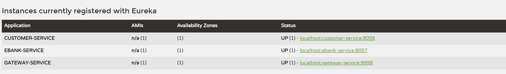

# E-Bank Microservices Application

## 1. Présentation du projet

Ce projet consiste à concevoir et développer une application bancaire basée sur une architecture **Microservices**, en utilisant **Spring Boot** et **Spring Cloud**.

L'application permet de gérer les clients et leurs comptes bancaires à travers plusieurs microservices indépendants qui communiquent entre eux.

Le projet est réalisé en trois parties dans le cadre d'un travail académique.

## 2. Technologies utilisées

- Java
- Spring Boot
- Spring Cloud
- Spring Cloud Gateway
- Netflix Eureka
- OpenFeign
- Resilience4J
- Spring Data JPA
- REST API
- Swagger UI
- Postman
- Maven

## 3. Architecture du projet

Le projet est composé des microservices suivants :

| Microservice | Description |
|---|---|
| Customer-Service | Gestion des informations des clients. |
| EBank-Service | Gestion des comptes bancaires et communication avec Customer-Service. |
| Discovery-Service | Enregistrement et découverte des microservices. |
| Gateway-Service | Point d'entrée unique pour accéder aux différents microservices. |

## 4. Réalisation du projet

### Partie 1 : Architecture Microservices et communication

- Développement du Customer-Service.
- Développement du EBank-Service.
- Communication entre les deux services avec OpenFeign.
- Mise en place de la tolérance aux pannes avec Resilience4J (Circuit Breaker).
- Développement de l'API Gateway.
- Mise en place du Discovery Service.
- Test des services Backend avec Postman et Swagger UI.

### Screenshots :

### Partie 2

À compléter.

### Partie 3

À compléter.

HANANE TOUBALI