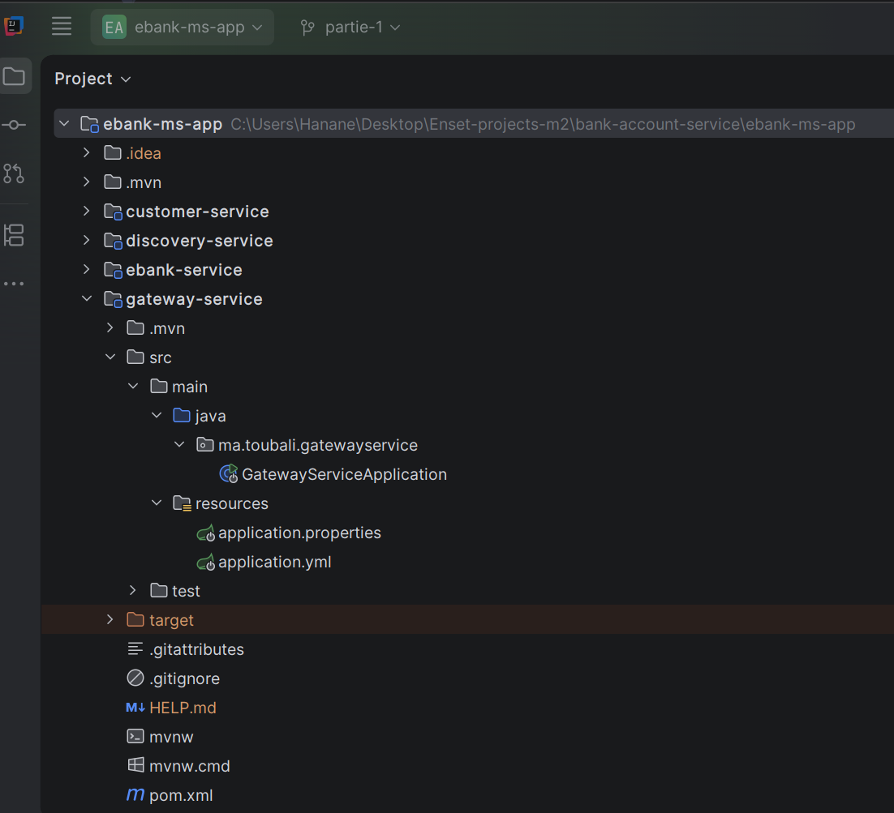
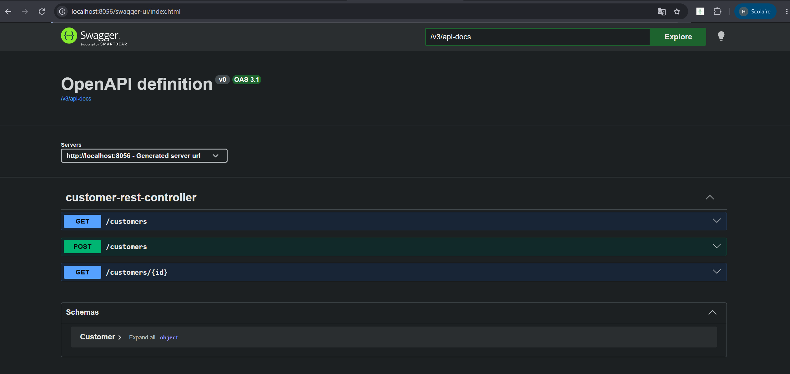
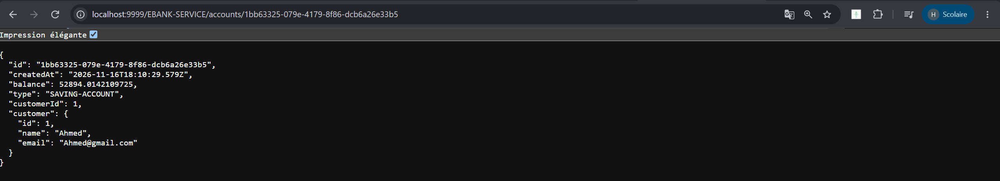
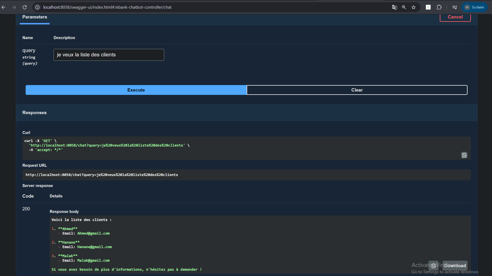
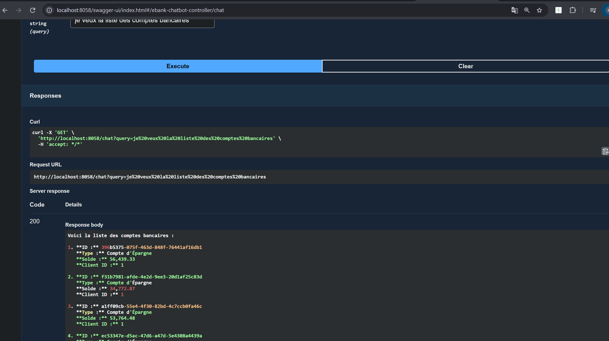
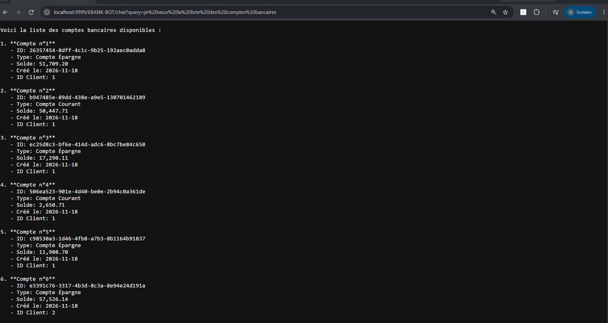
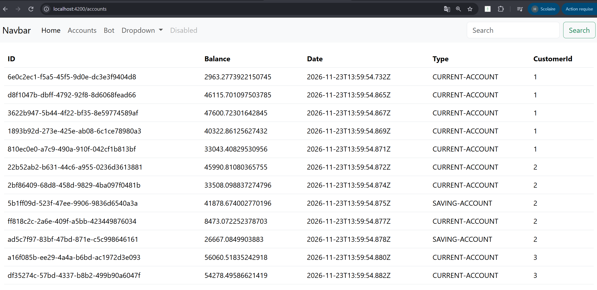
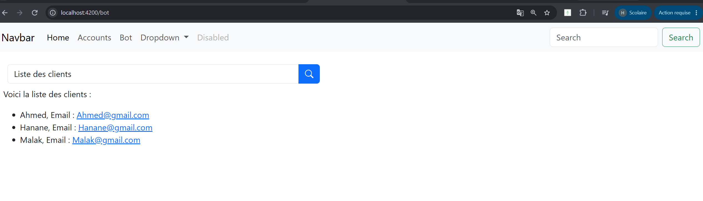

# E-Bank Microservices Application

## 1. Présentation du projet

Ce projet consiste à concevoir et développer une application bancaire basée sur une architecture **Microservices**, en utilisant **Spring Boot** et **Spring Cloud**.

L'application permet de gérer les clients et leurs comptes bancaires à travers plusieurs microservices indépendants qui communiquent entre eux.

Le projet est réalisé en trois parties dans le cadre d'un travail académique.

## 2. Technologies utilisées

- Java
- Spring Boot
- Spring Cloud
- Spring Cloud Gateway
- Netflix Eureka
- OpenFeign
- Resilience4J
- Spring Data JPA
- REST API
- Swagger UI
- Postman
- Maven

## 3. Architecture du projet

Le projet est composé des microservices suivants :

| Microservice | Description |
|---|---|
| Customer-Service | Gestion des informations des clients. |
| EBank-Service | Gestion des comptes bancaires et communication avec Customer-Service. |
| Discovery-Service | Enregistrement et découverte des microservices. |
| Gateway-Service | Point d'entrée unique pour accéder aux différents microservices. |

## 4. Réalisation du projet

### Partie 1 : Architecture Microservices et communication

- Développement du Customer-Service.
- Développement du EBank-Service.
- Communication entre les deux services avec OpenFeign.
- Mise en place de la tolérance aux pannes avec Resilience4J (Circuit Breaker).
- Développement de l'API Gateway.
- Mise en place du Discovery Service.
- Test des services Backend avec Postman et Swagger UI.

### Screenshots :

### Partie 2 : Intégration de l'Intelligence Artificielle avec Spring AI et MCP

Cette partie consiste à intégrer un agent conversationnel intelligent (AI Agent) à l'application E-Bank Microservices, en utilisant Spring AI et le protocole Model Context Protocol (MCP).

L'objectif est de permettre au chatbot d'interagir directement avec les microservices bancaires afin d'accéder à leurs fonctionnalités et de répondre aux demandes des utilisateurs.

#### 1. Développement de l'AI Agent
- Développement d'un AI Agent basé sur Spring AI.
- Mise en place du système de gestion des interactions conversationnelles.

#### 2. Intégration du protocole MCP
- Exposition des fonctionnalités des microservices via MCP.
- Test des fonctionnalités des microservices via un MCP Client.
- Connexion du chatbot aux microservices à l'aide du protocole MCP.

#### 3. Tests et intégration du Chatbot
- Test du chatbot avec un client REST.
- Intégration et test du chatbot avec un client Telegram.
- Intégration et test du chatbot avec un client Discord.

#### Screenshots

### Partie 3

### Partie 3 : Développement du Frontend avec Angular 

Cette partie consiste à développer l'interface utilisateur de l'application E-Bank Microservices avec Angular, afin de permettre la gestion des comptes bancaires et l'interaction avec l'AI Agent.

L'objectif est de créer une interface web moderne permettant aux utilisateurs d'accéder aux fonctionnalités bancaires et d'échanger avec l'agent conversationnel intelligent.

#### 1. Configuration du projet Angular:
- Création du projet avec Angular CLI et TypeScript.
- Intégration de Bootstrap 5 et Bootstrap Icons.
- Mise en place de la navigation avec Angular Router.
- Création d'une interface principale avec Navbar et Router Outlet.

#### 2. Développement du composant Accounts:
- Récupération des comptes bancaires via les API REST.
- Communication avec les microservices à travers Spring Cloud Gateway.
- Utilisation de HttpClient, inject(), Observables et Async Pipe.
- Affichage dynamique des comptes sous forme de tableau.
- Gestion des erreurs HTTP.

#### 3. Loading Service et HTTP Interceptor:
- Création d'un Loading Service basé sur Angular Signals.
- Mise en place d'un HTTP Interceptor pour suivre les requêtes HTTP.
- Utilisation de RxJS finalize() pour gérer le chargement.
- Affichage d'un Spinner Bootstrap.

#### 4. Développement du composant Bots (AI Chatbot):
- Création d'une interface conversationnelle interactive.
- Communication avec l'AI Agent via HttpClient.
- Affichage des réponses avec NGX-Markdown.
- Interaction avec les fonctionnalités bancaires via le protocole MCP.

#### 5. Streaming des réponses du Chatbot:
- Mise en place du streaming avec Spring AI et WebFlux (Flux<String>).
- Gestion des événements HTTP avec Angular et RxJS.
- Affichage progressif des réponses générées par l'AI Agent.

#### Screenshots:

**HANANE TOUBALI**

